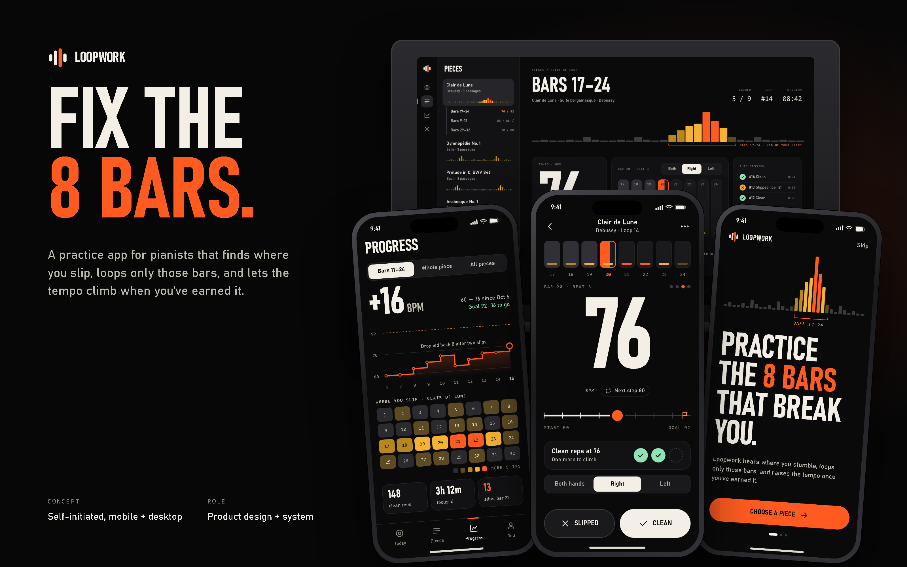

# Loopwork

- **What:** a mobile-first practice app (with a desktop companion) for pianists, designed as a self-initiated concept.
- **Problem:** people replay whole pieces, so the few bars that break them get a fraction of the practice time.
- **Idea:** Loopwork finds the slip-prone bars, loops only those, and raises the tempo one rung at a time when reps are clean.
- **Look:** dark, high-contrast, one loud tempo numeral, a single signal orange, and a warm heat ramp instead of red/green.
- **Contents:** 5 mobile screens (390x844), 2 desktop screens (1440x900), a design-system sheet, and [case-study.md](case-study.md).

© 2026 lbishopdev. All rights reserved. View only; see [LICENSE](LICENSE).
