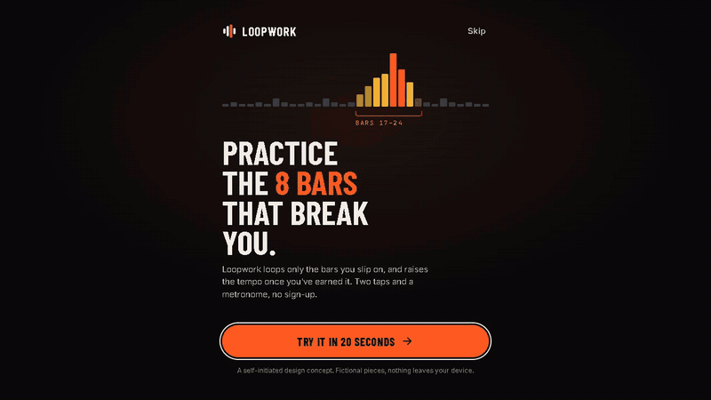

# Loopwork

**▶ [Try the live demo](https://loopwork.lbishop.app)**  ·  loopwork.lbishop.app

- **What:** a mobile-first practice app (with a desktop companion) for pianists, designed as a self-initiated concept.
- **Problem:** people replay whole pieces, so the few bars that break them get a fraction of the practice time.
- **Idea:** Loopwork finds the slip-prone bars, loops only those, and raises the tempo one rung at a time when reps are clean.
- **Look:** dark, high-contrast, one loud tempo numeral, a single signal orange, and a warm heat ramp instead of red/green.
- **Contents:** 5 mobile screens (390x844), 2 desktop screens (1440x900), a design-system sheet, and [case-study.md](case-study.md).

## Try the live demo

Loopwork is a working web-app version of this concept, not just screens. Open it on your phone or desktop and play with it for 20 seconds.

- **Real metronome.** Web Audio look-ahead scheduling, accented downbeat, volume and tap tempo.
- **Honest tempo ladder.** Tempo climbs a rung after N clean reps and drops back after two slips in a row. Edit the rules per passage.
- **Looping playhead.** A bar-by-bar playhead locked to the tempo, with Clean / Slipped buttons and `S`, `C`, `Space` shortcuts.
- **Alive on first open.** Sample practice history, a slip heatmap and tempo chart that update from what you actually play, plus a weekly review on desktop.
- **Installable and offline.** PWA with a conservative service worker. Everything stays in your browser (localStorage); there is a Reset demo data button.

[Open the live demo](https://loopwork.lbishop.app)

Self-initiated design concept. The pieces are original, fictional practice exercises, and there is no audio detection: you tell the app whether a pass was Clean or Slipped.

© 2026 lbishopdev. All rights reserved. View only; see [LICENSE](LICENSE).
